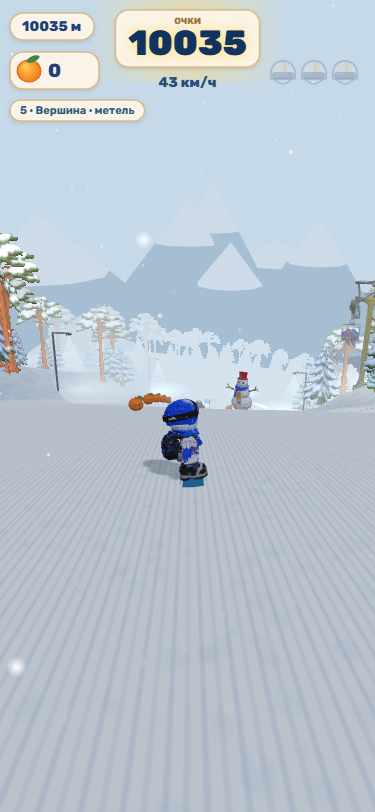

# Белая Сова · Спуск — механики и состояние игры

Срез на 18 ноября 2026 года. Версия `2026-11-18a`. «Белая Сова · Спуск» — мобильный 3D-раннер EMCO по заснеженному склону Шахтёрска. Игрок выбирает героя, спускается как можно дальше, набирает очки и открывает правила поведения на горнолыжном склоне.

[Играть в Telegram](https://t.me/belaya_sovabot/play) · [Играть в браузере](https://magliot.github.io/belaya-sova/) · [Осмотр трассы в браузере](https://magliot.github.io/belaya-sova/?preview=course) · [Репозиторий](https://github.com/magliot/belaya-sova)

## Как проходит заезд

В меню «Поехали!» открывает длинный спуск. «Короткий спуск · 1,2 км» открывает заезд с финишной аркой, воротами, двумя порциями кофе, лесными проходами, снеговиком и трамплинами. Очки, мандаринки и задания учитываются по обычным правилам. Кнопка «Ещё раз» повторяет выбранный формат.

1. **Выбрать героя.** Мишаня едет на лыжах и пробивает небольшие сугробы. Сова едет на сноуборде, чуть резче рулит и дольше остаётся в воздухе. Второй герой становится соперником под управлением игры.
2. **Рулить по извилистой трассе.** Герой разгоняется сам. На телефоне движение пальца влево или вправо задаёт положение на склоне. После отпускания сохраняется направление движения, поэтому на повороте можно врезаться в борт. На компьютере можно рулить стрелками влево и вправо или клавишами `A` и `D` в латинской раскладке.
3. **Собирать мандаринки и держать серию ворот.** Светящийся проём показывает, куда ехать. На обычных участках слалом идёт сериями по 4–7 ворот с чередованием сторон. Пропуск сбрасывает серию, каждые пять удачных ворот подряд дают следующую ступень множителя очков, до ×10.
4. **Прыгать и делать трюки.** Для взлёта нужно заехать на трамплин. В воздухе работают свайпы и короткое касание, на компьютере — пробел или стрелка вверх. В наборе восемь трюков, среди них грэб, вертушки и сальто. Слишком поздний трюк может привести к жёсткому приземлению, замедлению и потере серии.
5. **Объезжать препятствия.** На трассе есть лыжники, сноубордисты, дети с инструкторами, пешеходы и сидящие отдыхающие, а также камни, сетки, деревья, снежные пушки и встречные или попутные ратраки. Вежливые обгоны с запасом приносят очки и помогают открыть правила FIS. Соперник сам проходит ворота, прыгает и держится поблизости, периодически меняясь с игроком местами. Касание соперника не сбивает игрока.
6. **Уходить от лавины.** Первая погоня начинается около 900 м. В обычном темпе от неё можно уйти, а падения и замедления дают ей приблизиться. За успешный уход начисляются бонусные очки. При сильном столкновении каска позволяет встать и продолжить. Без запаса касок такое столкновение завершает заезд.

Счёт складывается из пройденных метров и бонусов за ворота, трюки, обгоны, предметы и испытания. Сверху крупно видны очки, дистанция, мандаринки и три отдельные рисованные каски. Сообщения о событиях появляются компактно у нижнего края. Экран результата показывает дистанцию, этап, ворота, серию, трюки и заработанные мандаринки. Результатом можно поделиться в Telegram.

## Восемь этапов трассы

Каждый участок занимает 2,5 км. Первый круг занимает 20 км, затем набор этапов повторяется с более высоким темпом. Траектория и профиль склона заданы в коде, а набор и положение многих объектов меняются между заездами.

| Дистанция первого круга | Этап | Как меняется заезд |
|---|---|---|
| 0–2,5 км | Учебный склон | Дневной широкий склон, первые серии ворот, дети и инструкторы. Можно освоить обгоны и трамплины. |
| 2,5–5 км | Лесная тропа | Подготовленная полоса сужается до 13,5 м. Близкие деревья и чередующиеся проходы заставляют выбирать траекторию. Широкий проход ведёт к воротам, узкий между деревьями — к ряду мандаринок. |
| 5–7,5 км | Бугры | Поля широких гребней и ложбин меняют высоту и ход героя. При неудачном пересечении гребня можно подскочить или жёстко приземлиться. Слева тянется пологая извилистая ложбина, правее — ускоренная линия по гребням. |
| 7,5–10 км | Сноупарк | Снежные борта до 4,2 м, размеченные трамплины и боксы с плавным въездом. Трюки дают двойные очки. На одном подходе можно выбрать трамплин или бокс. За проезд по боксу начисляется отдельный бонус. |
| 10–12,5 км | Вершина · метель | Светлая метель снижает контраст вдали, порывы ветра сносят героя, снеговики у бортов бросают снежки поперёк склона. |
| 12,5–15 км | Чёрная трасса | Повышенная базовая скорость, сужения у сеток, ратраки и снежные пушки. На решение об объезде меньше времени. |
| 15–17,5 км | Ночная трасса | Ориентиры — фонарь героя, фонари вдоль склона и светящиеся ворота. Возможна редкая встреча с йети. |
| 17,5–20 км | Новогодний городок | Праздничный свет и фейерверки, ряды подарков, перебегающие собаки и редкие снеговики. |

## Предметы и прогресс

- **Мандаринки.** Дают очки за подбор и пополняют кошелёк по итогам заезда. Дополнительные мандаринки выдаются за задания.
- **Кофе.** Даёт +65% к скорости на 4,5 секунды до улучшений и временно защищает от большинства препятствий. Снежный борт всё равно требует руления.
- **Каски EMCO.** Подобранная каска страхует от одного сильного столкновения. В заезде помещается до трёх. Купленная стартовая каска расходуется при старте; обычно герой начинает без запаса.
- **Магнит, перо, подарки.** Магнит временно притягивает мандаринки. Редкое золотое перо и подарки дают очки и учитываются в коллекции. Йети редко появляется на вершине и на ночном этапе. Встреча даёт очки и записывается в коллекцию.
- **Задания и улучшения.** В меню одновременно три задания на дистанцию, счёт, серию ворот, трюки и другие действия. На каждом этапе появляется отдельное испытание на бонусные очки. Мандаринки можно потратить на прокачку длительности кофе и магнита или стартовую каску.
- **Коллекции и награды.** В игре собираются буквы слов `EMCO`, `СОВА`, `ШАХТЕРСК`, встречи и находки. Десять правил FIS открываются за конкретные действия, например за безопасный объезд детей или помощь пострадавшему. В меню пять танцев с условиями открытия.
- **Сохранения и рейтинг.** Личный рекорд и прогресс хранятся в браузере, в Telegram также используется CloudStorage. Общий рейтинг недели и за всё время работает внутри Telegram через сервер проекта.

## Снеговики

В коротком заезде снеговик стоит на 547 м, на Вершине первого круга — на 10 055 м. Он смотрит на приближающегося героя, замахивается и подаёт короткий звуковой сигнал перед первым броском. Попавший в героя снежок сбрасывает серию и ненадолго замедляет движение. На Вершине и в Новогоднем городке также встречаются случайные снеговики у бортов.

Чтобы увидеть встречу в осмотре, перейти к **10 035 м** и нажать «Поехать» на скорости ¼×. [Осмотр в Telegram](https://t.me/belaya_sovabot/play?startapp=course)

## Как продолжить работу в другой среде

1. Открыть существующий репозиторий `magliot/belaya-sova`, прочитать [`AGENTS.md`](../AGENTS.md) и [`handoff/STATUS.md`](STATUS.md). Для истории работы есть [предыдущий отчёт](ОТЧЁТ_О_РАБОТЕ.md).
2. Из корня запустить `node tools/serve.cjs docs 8766` и открыть `http://localhost:8766/`. Сборка и сервер рекордов для локальной проверки заезда не требуются. Для телефона ориентир по экрану — 375×812.
3. Для быстрой проверки открыть «Настройки → Осмотр трассы» или добавить `?preview=course`. Доступны восемь этапов, точный метр, скорость ¼×–6×, выбор героя и боковой позиции, пауза, один кадр и пробные кофе, прыжок и лавина. Падения от столкновений, сохранение прогресса и отправка рекордов в осмотре отключены.

Основная логика и отрисовка находятся в `docs/index.html`, профиль трассы — в `docs/course.js`, игровой HUD — в `docs/race-hud.js`, панель осмотра — в `docs/course-review.js`. Зимние GLB, включая снеговика, подключаются из `docs/models/winter.js`. Клиент использует three.js 0.160, GitHub Pages публикует `docs/` из `main`. Сервер рейтинга — `server/apps-script/Code.gs`. В заездах оба героя и соперник используют движения из Blender. Для оценки поз служит отдельная страница `docs/animation-test.html`. При загрузке движений игра использует базовую модель.
